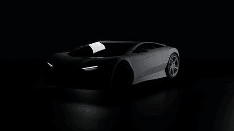
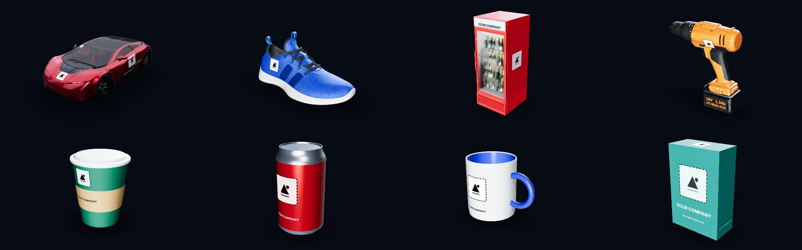

  

<h1 align="center">TheMark Studio</h1>

<b>Free 3D mockups with your logo — right in your browser.</b>

  <a href="https://themarkstudio.online"><b>➜ Open the Studio — themarkstudio.online</b></a>

Put your logo, colours and text on real 3D products — boxes, cans, coffee cups, mugs, bags, signs,
banners, phones, laptops, sneakers, drinks fridges, delivery trucks and sports cars — or on your own
3D model (`.glb` / `.gltf`). Turn it to any angle, then download a picture or a 3D file.
**Free, no sign-up, nothing uploaded** — your projects stay in your browser.

## What you can do

- **Start from a template** — packaging, merch, signs, vehicles and products, 25+ in all — or open your own GLB / glTF.
- **Add your brand** — logos (SVG or PNG), company name and colours. Save a Brand Kit once and every template opens with it.
- **Make it real** — recolour any part, pick finishes (metallic, matte, chrome, glass…), wrap a whole vehicle.
- **Download** a picture (PNG) or a 3D file (GLB) — free, also for business.

## Free resources from us

- [**free-3d-mockup-templates**](https://github.com/themarkstudio/free-3d-mockup-templates) — 18 blank product models (boxes, cans, bottles, cups, mugs, bags, signs, a truck, an ambulance) as GLB, free for any use.
- [**awesome-3d-mockups**](https://github.com/themarkstudio/awesome-3d-mockups) — free 3D models, textures, lighting and tools for product mockups, with their licences.

## Find us

[Website](https://themarkstudio.online) ·
[YouTube](https://www.youtube.com/@themarkstudio.online) ·
[LinkedIn](https://www.linkedin.com/in/themarkstudio) ·
[Instagram](https://instagram.com/themarkstudio.online) ·
[Facebook](https://facebook.com/themarkstudio.online) ·
[Pinterest](https://pinterest.com/themarkstudioonline) ·
themarkstudio.online@gmail.com

Credits — the car: “Car Concept” by Eric Chadwick, © 2024 Darmstadt Graphics Group GmbH, CC BY 4.0
(logos removed, repainted). The sneaker: “Materials Variants Shoe” by Shopify, CC BY 4.0 (emblem removed).
The drinks fridge: “Commercial Refrigerator” by Eric Chadwick, © Darmstadt Graphics Group GmbH, and
Sean Thomas, CC BY 4.0 (sign blanked). All from the Khronos glTF Sample Assets. The power drill:
“Drill 01” by Fernando Quinn (Poly Haven), CC0.
